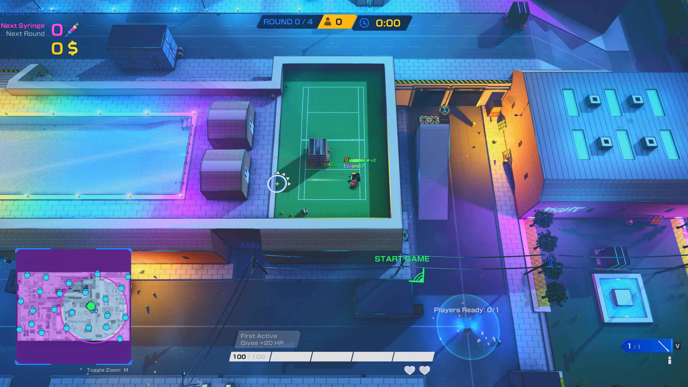
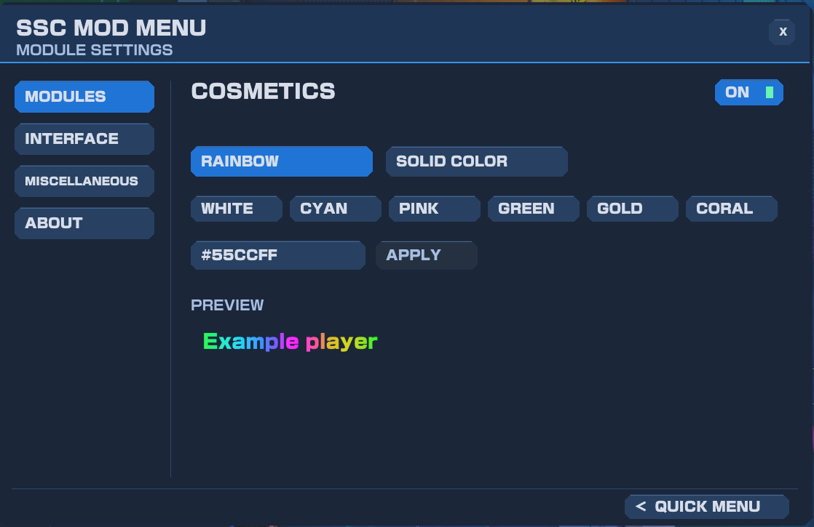
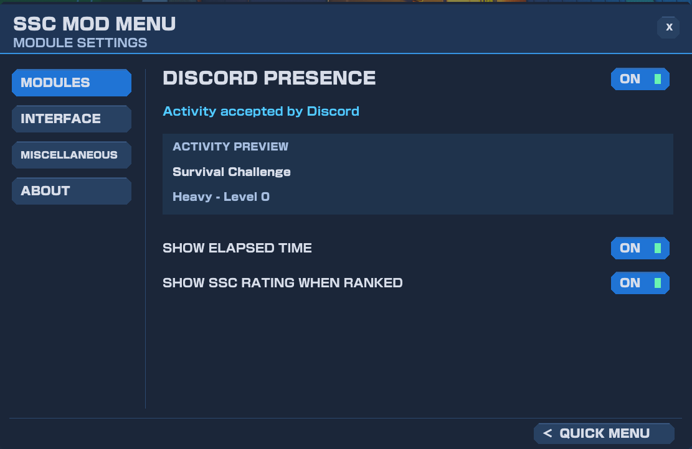

# SSC Mod Menu

An unofficial client-side mod for Skillshot City, with a Windows installer and an experimental Linux installer for Steam Proton.

Join my discord [here](https://discord.gg/T5h5GUwEG7) and ping me for any help!
## Download

[Download SSC Mod Menu for Windows](https://github.com/Epiano7/SSC-Mod-Menu/releases/latest/download/SSC-Mod-Menu-Setup.exe)

Run the installer and select your Skillshot City Steam folder. After installation, launch through Steam and press **Right Shift** to open the mod menu.

## Linux / Proton (experimental)

[Download SSC Mod Menu for Linux](https://github.com/Epiano7/SSC-Mod-Menu/releases/latest/download/SSC-Mod-Menu-Linux.tar.gz)

**Installation has been tested on Arch Linux with regular Steam and Proton Experimental. Some mod features are still untested on Linux.** Other distributions, Flatpak Steam, and in-game updating have not been verified

In **Skillshot City → Properties → Compatibility**, enable **Force the use of a specific Steam Play compatibility tool** and choose **Proton Experimental**. Let Steam download the Windows build and launch it once, then close the game and fully exit Steam

Extract the download, open **SSC-Mod-Menu-Setup**, select the folder containing **SkillshotCity.exe**, and click **Install / Update**. Reopen Steam and launch the game

The installer runs natively; the game and mod use Proton. The native Linux game is not supported yet. No separate Wine setup is needed. If the setup file does not open, allow executing it as a program in its file Properties

[Full Linux instructions and log export](linux/README.md)

## Modules

- **Sound Replacer:** import WAV or MP3 replacements for sound effects and music, preview clips, adjust individual volume, and replace related variants together. **All Music Tracks** uses one custom song across the music playlist. Track lengths are shown, and replacements apply after restarting the game
- **Cosmetics:** customize your name with a solid color, animated rainbow, or a custom gradient with up to three colors. Choose colors with the in-game picker or hex fields. Overrides apply across name displays, including chat and leaderboards, and support **Shared Cosmetics** to share your colors, receive other mod users' colors, or both. Both sharing controls start enabled with fresh settings; existing saved choices are preserved. [Details and supported displays](docs/shared-cosmetics.md)
- **Discord Presence:** shows game status, available round and level details, elapsed time, and SSC rating. Confirmed to work on the Windows Discord app, Linux is still experimental but should work for both flatpak and other installs
- **HUD Editor:** move and resize most HUD elements, save layouts, and reset individual elements
- **Custom Quick Chat:** customize the quick-react wheel with up to 12 messages per slot. The first message labels the wheel, and each use sends a randomly chosen message from that slot's list. Importing images is supported as well
- **Driving:** available in **All Modules**, with an optional Quick Menu pin. Camera-relative controls remap your movement keys at 45-degree heading boundaries while retaining native steering and braking. With the car facing left, A drives forward, D reverses, and W/S steer. Off by default; currently singleplayer-only.
- **Freecam:** a separate module in **All Modules**. Under **Misc**, hide the world-space crosshair and aiming indicators for screenshots or recording. This separate toggle is outside Creator Controls; freecam always hides them automatically. Menu cursors remain visible and the preference persists between launches. Experimental **Freecam** offers **Pan** (normal viewing angle, WASD/arrows, scroll-wheel zoom) and **3D Freecam** (unrestricted mouse-look (including full vertical rotations), W/S along your viewing direction, A/D strafing, Space up / left Shift down, scroll to move forward/back). Hold left Shift while scrolling for finer adjustments. Pan zoom ranges from 0.025 to 32 times the normal camera distance. 3D mouse-look keeps the horizontal axis level instead of accumulating roll. The **3D draw distance** options (1,000/2,000/4,000/8,000 game units or Full) can reduce distant scenery; Full preserves the existing range. View-volume bounds limit off-screen map submission conservatively, including elevated objects. 3D movement defaults to 1,200 game units per second and supports up to 12,000. Both modes have a movement-speed slider (drag or click and use arrow keys; Home/End select the limits) and optional HUD hiding. Version/FPS/ping has a separate hide toggle. Camera position and projection remain independent of the followed player; jumps, damage shake and native zoom changes do not move the free camera. Audio listener position follows the camera, with native distance attenuation. **Slow Movement** defaults to F6 while held, reducing camera movement to 10% without slowing the game simulation. Its key can be rebound and changed to Toggle mode. Choose the mode before entering; rotation and camera position reset on exit. Enter it during a game; Escape exits and Right Shift opens the mod menu. Alt-tab releases input and retains the camera; it exits on session changes and never stays active after restarting. Locally hosted single-player retains your character, including solo Survival and campaign sessions with an active local network transport; networked games require a dead player or spectator, and respawning exits freecam. Alive multiplayer entry displays a brief error. **Photo Settings** offers an opt-in F8 freeze key (rebindable), active only during offline freecam; multiplayer remains live. Photo Settings also offers **Hide shadows in Freecam**, a render-only workaround for native shadow-map boundaries at large zoom distances; normal shadow settings are restored after each draw. This freezes the simulation update, not every shader/UI animation. In 3D mode, player nameplates, health/shield bars, object labels, XP-pool labels and supported floating text face the camera; LEVEL UP messages are included; live gameplay verification remains pending; normal Pan rendering retains the game's orientation. Unusual 3D angles may expose missing model backs or scenery, and wide views can cost performance.
- **Auto Messages:** message rules using events, conditions, variables, and repeat counts. Choose **Conditions are met** to watch your conditions continuously, or use a round/level/health event. Under **Edit rule → Timing / Cancellation**, require conditions to stay true for up to 60 seconds, delay sending for up to 60 seconds, and optionally cancel if you die. Each rule triggers at most once per round; pending messages cancel on round changes, disconnects, or rule edits. Existing rules retain their previous timing. Rule sharing uses `SSC-AM3`; older `SSC-AM1` and `SSC-AM2` codes can still be imported.

## Other features

- **Weapon Lab:** search weapons by name, tier, or type. Compare up to four weapons with stronger values highlighted; adjust health, shields, and miss chance; and watch a timed duel with reloads. Simulations are estimates and do not account for skills or other round perks like shop purchases 
- **Match Recording:** optionally save observed Battle Royale rounds together in a local match file, including class, level, XP, cash, health, weapons, selected skills, skill levels and stim state. The recording preference persists between rounds and restarts. Recordings stay on your PC
- **Personal Statistics:** browse local recordings by class and date, view summary statistics, and inspect larger level, XP and cash graphs with grid options and hover values. Late joins and unavailable fields are distinguished from complete observations. Older recordings cannot recover data they never captured
- **Interface:** adjust UI scale, choose which modules appear in the quick menu, and customize animation and HUD display preferences. Text edits save when leaving the field
- **Geri Challenge:** hide the skill-draft and syringe selection panel from **All Modules > Misc**. Disabled by default; switch it off to restore the panel. This hides the UI and does not enforce challenge rules. [Details and testing limits](docs/geri-challenge.md)
- **Updates:** check for releases through the in-game prompt. Available updates can be dismissed for that version, and release notes can be disabled separately

For version-by-version changes, see the [GitHub releases](https://github.com/Epiano7/SSC-Mod-Menu/releases)

## Screenshots

A custom HUD layout in game:

Cosmetics and Discord Presence settings

## Compatibility

The menu will install into your Skillshot City Steam folder. Each native module checks its dependencies at startup for compatibility issues. Game updates might break some modules depending on the update, in which a hotfix will be released. Larger game changes may still require a mod update.

If something goes wrong, open **All Modules > About > Open logs**, and dm them to Epiano7 or make an issue here with them included. Startup checks are recorded in `runtime.log`; crash reports are saved under `diagnostics` when Windows allows the crash handler to run. These reports are not automatically uploaded to any servers and stay local. Minidumps can contain process data, so review them before sharing.

## Credits
- bencelot (dev of SSC) for giving feedback before this released and for making the game!
- everyone in the [SSC discord](https://discord.gg/skillshotcity) that provided feedback regarding early module dev, thank you!
- for some more specific names:
  - yari_check for testing out the Linux build and helping me suffer through an Arch VM install
  - jyxalag for reviewing early builds and testing out the private access feature
  - alsamandal for resisting against the Manga Recruit monopoly!
  - ironmonkey808 for giving great feedback and making a really cool [SSC Starter Guide!](https://www.youtube.com/watch?v=2uc2Ax52kMk), and for putting up with me 
  joining his lobbies in the last 2 minutes and winning
  - chill for being a chill guy (and for giving some great suggestions)
  - geri, founder of the Geri Challenge (fan-made challenge where you aren't allowed to draft skills)
  - mang for answering a ton of questions I had as a new player and for their work on a synergy chart (which is planned to be implemented in the mod soon)
  - deus for building my hatred for snipers so much that I always keep one in my second weapon slot :D

[Build instructions](docs/build.md) | [Contributing](CONTRIBUTING.md) | [Installer details](installer/README.md)

## Private access

Privately approved beta testers can enter an activation code under **Private access**. Later launches check access automatically. Private activation currently requires native Windows; see the [Linux guide](linux/README.md) for platform limits
